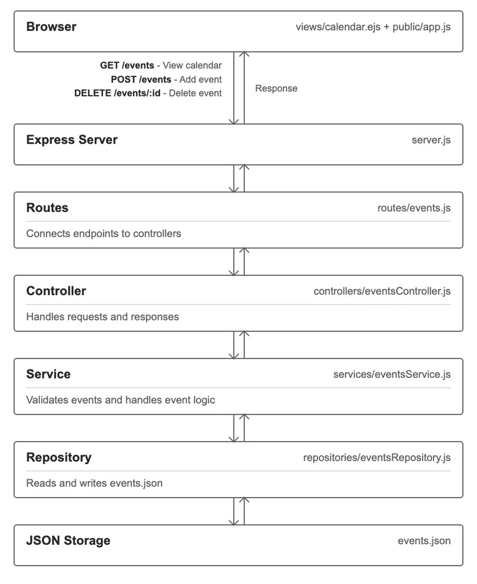

Akhila Garre - garreakhila
Daniel Qi - danyman19
Mai Le - mainle-git

Working agreement:

- "Done" for a PR means at least one member of the group approved it.
- Communication: We have exchanged numbers, so we will communicate through iMessage
- Splitting work: Before each assignment we will divy up the work through IMessage
- Disagreements: We will make sure to work through any disagreements professionally and stay open-minded through our conversations and will communicate our thoughts.

# What is Syllabus-to-Calendar Parser?

Syllabus-to-Calendar Parser is a tool that allows users to copy and paste text from a course syllabus. The application uses string processing or a lightweight API to identify important due dates and display them in a custom, interactive dashboard calendar.

# Design Decision:

### Akhila Garre

#### Decision: Service-layer validation

I decided to place the event validation in the service layer rather than the controller or repository. I contemplated keeping the validation in the controller layer as well as it could validate incoming requests but I felt like it would mix business rules with HTTP request handling and make it more complicated to reuse those rules. Even if I had enforced the validation in the repository, it would also mix the validation logic with file storage responsibilites. By keeping the validation in the service layer, we can enforce consistent rules before events are saved regardless of how the service is called. This way it is also easier to test and maintain the code for the future if we ever decide to change how events are stored or add ways to create events. In the end, we decided to keep the validation checks in the services layer because it helps format everything for the repository and the services layer will check formatting and own the rules. The repository layer is kept just for receiving informaition, not checking for formatting. Now the files are all organized separately where the controller will handle requests and responses, the service validates event rules and the repository will read and write events.json.

### Mai Le

#### Decision: Using JSON file storage

We chose to store calendar events in events.json instead of MongoDB for now as it's easier to set up, test, and manage without needing a database. Although MongoDB would be better for larger applications with more users, but JSON was enough for our current feature. We can still switch to a database in the future by keeping the storage operations in the repository layer.

### Daniel Qi

#### Decision: Click a date to create an event

I decided to, UI wise, have a user create an event by clicking on the date they want the event to be at. The alternative would be for the user instead to fill out a form where they have to manually enter the month and the date along with the title and description. I felt like it would be easier for the user to just click on they day they wanted which would also prevent user related errors when entering the date. Another reason this system works is because right now the calendar only shows the current month. If we were to add the ability to move between months it could be useful for the user to so be able to create an event without having to cycle to that month in the calendar.

## Setup

### 1. Clone the repository

```bash
git clone https://github.com/danyman19/326_Project.git
cd 326_Project
```

### 2. Install dependencies

```bash
npm install
```

### 3. Start the server

```bash
npm start
```

### 4. Open app

Go to

```text
http://localhost:3000
```

To access the calendar

```text
http://localhost:3000/events
```

Calendar Feature

## Overview

For Sprint 2, our team implemented a calendar that allows users to add, view, and delete events. Users can select a date, view, and delete events. Events are saved in `events.json` and remain available after restarting the server.

## How to use the Calendar

1. Start the server using npm start
2. Open http://localhost:3000/events
3. Click on a date in the calendar to add an event
4. Enter an event title and description
5. Click "Add entry" to save the event. The new event event will be on the selected date. lick "Cancel" if you don't want to add the event
6. Click on an existing event to view its title, date, and description
7. Click Delete to remove the event, or Close to return to the calendar without making changes

## Validation and Error Handling

**Day and month**: must be valid integers, with the month between 1 and 12 and the day within the allowed range. Invalid dates will return `400 Bad Request`.
**Event title**: must be nonempty text. Missing or invalid titles return `400 Bad Request`.
**Event description**: Optional, but must be text. Invalid descriptions return `400 Bad Request`.
**Event deletion**: delete a nonexistent event return `404 Not Found`.
**Unknown routes**: requests to nonexistent routes return `404 Not Found`.
**Server errors**: Unexpected errors are logged and return `500 Internal Server Error`
**Frontend errors**: displays alerts for failed requests, connection errors, or timeouts.

## System Diagram


